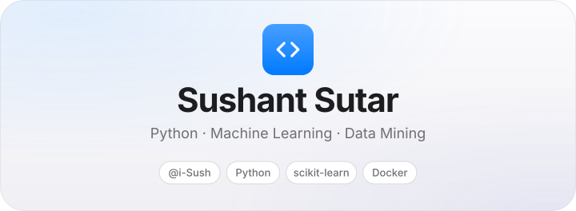
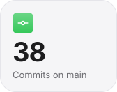
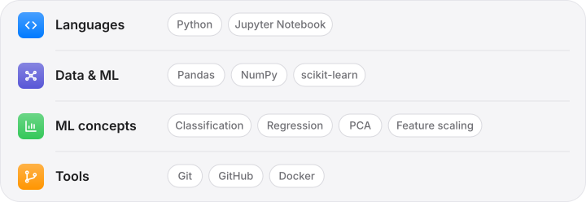
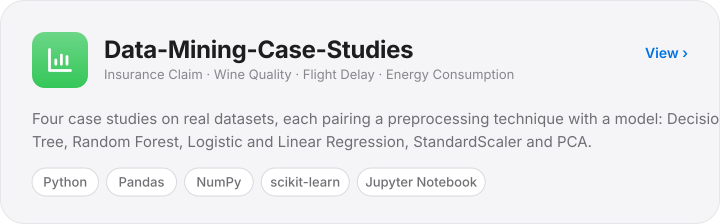

<!--
  PROFILE DASHBOARD (iOS style) for i-Sush
  Lines marked EDIT are placeholders or assumptions to confirm before publishing.
  All facts were verified on github.com/i-Sush on 7 Nov 2026.
-->

<a href="https://github.com/i-Sush"><picture><source media="(prefers-color-scheme: dark)" srcset="./assets/hero-dark.svg"></picture></a>

<a href="#about">About</a> &nbsp;·&nbsp; <a href="#stack">Stack</a> &nbsp;·&nbsp; <a href="#projects">Projects</a> &nbsp;·&nbsp; <a href="#learning">Learning</a> &nbsp;·&nbsp; <a href="#streak">Streak</a> &nbsp;·&nbsp; <a href="#connect">Connect</a>

## About

I'm an early-career developer building strong foundations in **Python, machine learning and data mining**. My public repositories are a record of that work: case studies on real datasets with scikit-learn, an AI/ML practice repository, and structured notes on Docker and Git.

I like taking a concept, running it on real data and seeing what actually changes, for example how feature scaling and PCA affect a model on wine-quality or household energy data.

**Looking for:** internships and entry-level roles in ML or data-focused development. <!-- EDIT: confirm or rewrite this goal -->

<a href="https://github.com/i-Sush?tab=repositories"><picture><source media="(prefers-color-scheme: dark)" srcset="./assets/stat-repos-dark.svg"></picture></a>
<a href="https://github.com/i-Sush/AI-ML/commits/main/"><picture><source media="(prefers-color-scheme: dark)" srcset="./assets/stat-commits-dark.svg"></picture></a>
<a href="https://github.com/i-Sush/Data-Mining-Case-Studies"><picture><source media="(prefers-color-scheme: dark)" srcset="./assets/stat-cases-dark.svg"></picture></a>
<a href="https://github.com/i-Sush/Docker"><picture><source media="(prefers-color-scheme: dark)" srcset="./assets/stat-docker-dark.svg"></picture></a>

Snapshot as of 7 Nov 2026. Commits are counted on the main branch of each public repository.

## Stack

<picture><source media="(prefers-color-scheme: dark)" srcset="./assets/stack-dark.svg"></picture>

<!-- Frontend, backend and database are omitted on purpose: no public repository shows them yet. -->

## Projects

<a href="https://github.com/i-Sush/Data-Mining-Case-Studies"><picture><source media="(prefers-color-scheme: dark)" srcset="./assets/card-data-dark.svg"></picture></a>

<a href="https://github.com/i-Sush/AI-ML"><picture><source media="(prefers-color-scheme: dark)" srcset="./assets/card-ai-dark.svg"></picture></a>
<a href="https://github.com/i-Sush/Docker"><picture><source media="(prefers-color-scheme: dark)" srcset="./assets/card-docker-dark.svg"></picture></a>

Also: <a href="https://github.com/i-Sush/Git_Github">Git_Github</a> (Git and GitHub basics). Full details in the <a href="./projects/projects.md"><b>project portfolio</b></a>.

## Learning

<picture><source media="(prefers-color-scheme: dark)" srcset="./assets/learning-dark.svg"></picture>

<!-- EDIT (optional): to add a topic, open assets/learning-light.svg and learning-dark.svg in a text editor and copy one row -->

## Streak

<a href="./streak/README.md"><picture><source media="(prefers-color-scheme: dark)" srcset="https://streak-stats.demolab.com?user=i-Sush&background=1C1C1E&ring=0A84FF&fire=FF9F0A&currStreakLabel=0A84FF&sideLabels=A1A1A6&currStreakNum=F5F5F7&sideNums=F5F5F7&dates=8E8E93&stroke=2C2C2E&border=2C2C2E&border_radius=22"></picture></a>

<a href="./streak/README.md"><b>Open the full streak dashboard →</b></a>

## Connect

<a href="https://github.com/i-Sush"><picture><source media="(prefers-color-scheme: dark)" srcset="./assets/btn-github-dark.svg"></picture></a>
<a href="https://www.linkedin.com/in/YOUR-LINKEDIN-ID"><picture><source media="(prefers-color-scheme: dark)" srcset="./assets/btn-linkedin-dark.svg"></picture></a>
<a href="mailto:YOUR_EMAIL@example.com"><picture><source media="(prefers-color-scheme: dark)" srcset="./assets/btn-email-dark.svg"></picture></a>

<!-- EDIT: replace YOUR-LINKEDIN-ID and YOUR_EMAIL@example.com, or delete those two buttons. -->

<a href="#about">Back to top ↑</a>

