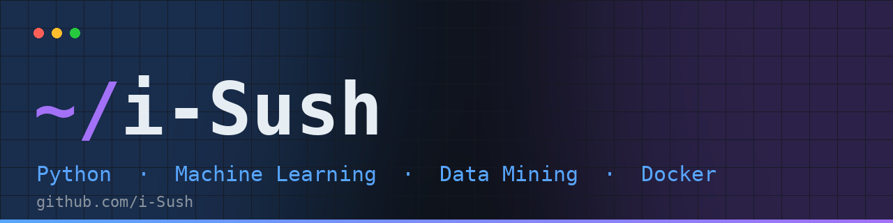
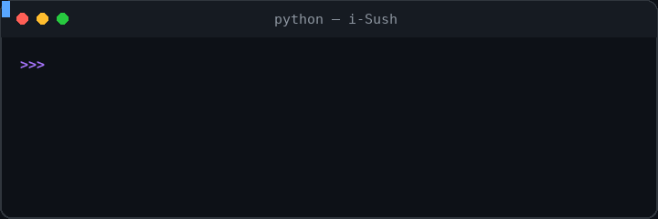

<!--
  PROFILE DASHBOARD — i-Sush
  Lines marked  EDIT  are placeholders or assumptions you should confirm before publishing.
  Only facts verified on github.com/i-Sush (checked 7 Nov 2026) are written as plain text.
-->

<!-- EDIT: change the first typing line above if you prefer a different title -->

  <b>Sushant Sutar</b> &nbsp;·&nbsp; <code>i-Sush</code> 
  Building real understanding of machine learning, one dataset at a time.

  
  
  

<!-- EDIT: replace YOUR-LINKEDIN-ID and YOUR_EMAIL@example.com, or delete those two badges -->

  <a href="#about">About</a> &nbsp;·&nbsp;
  <a href="#technology-stack">Stack</a> &nbsp;·&nbsp;
  <a href="#featured-projects">Projects</a> &nbsp;·&nbsp;
  <a href="#currently-learning">Learning</a> &nbsp;·&nbsp;
  <a href="#github-statistics">Stats</a> &nbsp;·&nbsp;
  <a href="#github-streak">Streak</a> &nbsp;·&nbsp;
  <a href="#connect">Connect</a>

## About

<table>
<tr>
<td valign="top">

I'm an early-career developer building strong foundations in **Python, machine learning and data mining**. My public repositories are a record of that work: case studies on real datasets with scikit-learn, an AI/ML practice repository, and structured notes on **Docker** and **Git** as I learn the tools used to ship software.

I like taking a concept, running it on real data and seeing what actually changes, for example how feature scaling and PCA affect a model on wine-quality or household energy data.

**Interests:** classification and regression, data preprocessing, dimensionality reduction, model evaluation.

**Looking for:** internships and entry-level roles in ML or data-focused development. <!-- EDIT: confirm or rewrite this goal -->

</td>
<td width="340" valign="middle" align="center">

</td>
</tr>
</table>

<!-- EDIT (optional): add one line about your college / degree / graduation year -->

## Technology Stack

Only technologies that appear in my public repositories are listed.

| Category | Technologies | Used in |
| :-- | :-- | :-- |
| **Languages** |   | [AI-ML](https://github.com/i-Sush/AI-ML), [Data-Mining-Case-Studies](https://github.com/i-Sush/Data-Mining-Case-Studies) |
| **Data and ML libraries** |    | [Data-Mining-Case-Studies](https://github.com/i-Sush/Data-Mining-Case-Studies) |
| **ML concepts** | Decision Trees · Random Forest · Logistic and Linear Regression · PCA · StandardScaler · Model evaluation (accuracy, MSE) | [Data-Mining-Case-Studies](https://github.com/i-Sush/Data-Mining-Case-Studies) |
| **Tools and platforms** |    | [Git_Github](https://github.com/i-Sush/Git_Github), [Docker](https://github.com/i-Sush/Docker) |

<!-- Frontend, Backend and Database rows are intentionally omitted: no public repository shows them yet. Add rows when you publish that work. -->

## Featured Projects

<table>
<tr>
<td width="56" align="center" valign="top"></td>
<td>

### [Data-Mining-Case-Studies](https://github.com/i-Sush/Data-Mining-Case-Studies)
Four case studies on real datasets, each pairing a preprocessing technique with a model.

- **Insurance Claim Prediction:** Decision Tree classification
- **Wine Quality Analysis:** StandardScaler and PCA with Random Forest / Logistic Regression
- **Flight Delay Prediction:** cleaning, scaling, PCA and a Decision Tree
- **Energy Consumption:** impact of feature scaling on Linear Regression

    

</td>
</tr>
</table>

<table>
<tr>
<td width="56" align="center" valign="top"></td>
<td>

### [AI-ML](https://github.com/i-Sush/AI-ML)
A learning repository for AI/ML algorithms, projects and practical implementations, built up over 21 commits.

</td>
</tr>
</table>

<table>
<tr>
<td width="56" align="center" valign="top"></td>
<td>

### [Docker](https://github.com/i-Sush/Docker)
A phase-by-phase Docker learning journey with notes and sample containers: installation and first container, then Docker and container fundamentals.

</td>
</tr>
</table>

More, including the Git and GitHub notes, in the **[full project portfolio](./projects/projects.md)**.

## Currently Learning

| Topic | Where it shows up |
| :-- | :-- |
| **Machine learning in Python** | Algorithms and practice in [AI-ML](https://github.com/i-Sush/AI-ML); applied case studies in [Data-Mining-Case-Studies](https://github.com/i-Sush/Data-Mining-Case-Studies) |
| **Docker and containers** | Phase 1 and Phase 2 notes in [Docker](https://github.com/i-Sush/Docker) |
| **Git and GitHub workflows** | [Git_Github](https://github.com/i-Sush/Git_Github) |
| **Next up** | *EDIT: add what you want to explore next, e.g. a new algorithm, library or project* |

## GitHub Statistics

  
  

Cards are generated live from public GitHub data. The repository-count badge is manual; update it when you add repos.

## Contribution Activity

## GitHub Streak

<a href="./streak/README.md"><b>Open the full streak dashboard →</b></a>

## Achievements

No GitHub achievement badges earned yet, and none are claimed here. What I can show instead are milestones verifiable on my public profile (as of 7 Nov 2026):

| Milestone | Evidence |
| :-- | :-- |
| 4 public repositories | [Repositories tab](https://github.com/i-Sush?tab=repositories) |
| 38 commits across the main branches of those repos | [AI-ML](https://github.com/i-Sush/AI-ML/commits/main/) (21) · [Data-Mining-Case-Studies](https://github.com/i-Sush/Data-Mining-Case-Studies/commits/main/) (8) · [Docker](https://github.com/i-Sush/Docker/commits/main/) (8) · [Git_Github](https://github.com/i-Sush/Git_Github/commits/main/) (1) |
| 4 data-mining case studies | [Data-Mining-Case-Studies](https://github.com/i-Sush/Data-Mining-Case-Studies) |

<!--
  When you earn a GitHub Achievement, add it here, for example:
  
-->

## Repository Activity

| Repository | Focus | Language | Commits |
| :-- | :-- | :-- | --: |
| [AI-ML](https://github.com/i-Sush/AI-ML) | Algorithms, projects, practice | Python | 21 |
| [Data-Mining-Case-Studies](https://github.com/i-Sush/Data-Mining-Case-Studies) | Applied ML case studies | Jupyter Notebook | 8 |
| [Docker](https://github.com/i-Sush/Docker) | Phased Docker learning notes | Notes and containers | 8 |
| [Git_Github](https://github.com/i-Sush/Git_Github) | Git and GitHub basics | Notes | 1 |

Commit counts are on each repo's main branch as of 7 Nov 2026. Language mix over time is in the <a href="#github-statistics">Most Used Languages</a> card.

## Connect

<!-- EDIT: portfolio website (uncomment and fill in when you have one)

-->

  
<a href="#about">Back to top ↑</a>

