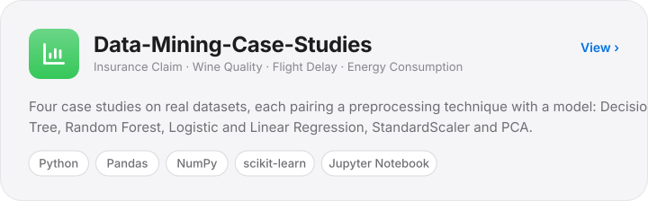

# Project Portfolio

<a href="../README.md">← Back to main dashboard</a> &nbsp;·&nbsp; <a href="https://github.com/i-Sush?tab=repositories">All repositories</a>

Reviewed against github.com/i-Sush on 7 Nov 2026. No live demos exist yet, so none are listed.

## AI and Machine Learning

<a href="https://github.com/i-Sush/Data-Mining-Case-Studies"><picture><source media="(prefers-color-scheme: dark)" srcset="../assets/card-data-dark.svg"></picture></a>

**Overview.** Basic data mining and machine learning case studies in Python on real-world datasets, covering classification, feature scaling and dimensionality reduction. Part of my academic learning and practice. Models are evaluated with accuracy and MSE.

| Case study | Task | Techniques and algorithm | Dataset |
| :-- | :-- | :-- | :-- |
| [Insurance Claim](https://github.com/i-Sush/Data-Mining-Case-Studies/tree/main/Insurance_Claim) | Classification: will a claim be approved? | Decision Tree | Insurance Claims Dataset |
| [Wine Quality](https://github.com/i-Sush/Data-Mining-Case-Studies/tree/main/Wine_Quality) | Classification: quality from chemical properties | StandardScaler, PCA, Random Forest / Logistic Regression | Wine Quality (UCI) |
| [Flight Delay Prediction](https://github.com/i-Sush/Data-Mining-Case-Studies/tree/main/End-to-End_Preprocessing_Flight_Delay_Prediction) | Classification: will a flight be delayed? | Data cleaning, scaling, PCA, Decision Tree | Flight Delay (USDOT / Kaggle) |
| [Energy Consumption](https://github.com/i-Sush/Data-Mining-Case-Studies/tree/main/Feature_Scaling_In_Energy_Consumption_Data) | Regression: effect of scaling on forecasting | StandardScaler, Linear Regression | Household Electric Power Consumption (UCI) |

The repository also contains a [Viva-Questions.md](https://github.com/i-Sush/Data-Mining-Case-Studies/blob/main/Viva-Questions.md) revision file.

<a href="https://github.com/i-Sush/AI-ML"><picture><source media="(prefers-color-scheme: dark)" srcset="../assets/card-ai-dark.svg"></picture></a>

**Overview.** A learning repository for AI/ML algorithms, projects and practical implementations, organised under a `PYTHON` folder. **Learning goal:** build working implementations of core ML ideas rather than only reading about them.

## Developer Tools and DevOps Learning

<a href="https://github.com/i-Sush/Docker"><picture><source media="(prefers-color-scheme: dark)" srcset="../assets/card-docker-dark.svg"></picture></a>

**Overview.** A personal Docker learning journey with experiments, notes and sample containers.

- [Phase 1: Docker Installation and First Container](https://github.com/i-Sush/Docker/tree/main/Phase%20%201%20-%20Docker%20Installation%20%26%20First%20Container)
- [Phase 2: Docker Introduction and Container](https://github.com/i-Sush/Docker/tree/main/Phase%202%20-%20Docker%20Introduction%20%26%20Container)

**Git_Github.** [A repository for learning Git and GitHub](https://github.com/i-Sush/Git_Github). It is at an early stage (1 commit, a README). **Learning goal:** get comfortable with version control and the GitHub workflow used in team projects.

<a href="#project-portfolio">Back to top ↑</a> &nbsp;·&nbsp; <a href="../README.md">Main dashboard</a>

