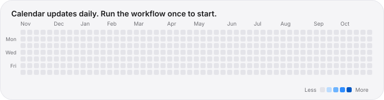

<a href="https://github.com/i-Sush"><picture><source media="(prefers-color-scheme: dark)" srcset="../assets/hero-dark.svg"></picture></a>

# GitHub Streak

<a href="../README.md">← Back to main dashboard</a>

<a href="https://github.com/i-Sush"><picture><source media="(prefers-color-scheme: dark)" srcset="https://streak-stats.demolab.com?user=i-Sush&background=1C1C1E&ring=0A84FF&fire=FF9F0A&currStreakLabel=0A84FF&sideLabels=A1A1A6&currStreakNum=F5F5F7&sideNums=F5F5F7&dates=8E8E93&stroke=2C2C2E&border=2C2C2E&border_radius=22"></picture></a>

<picture><source media="(prefers-color-scheme: dark)" srcset="../assets/calendar-dark.svg"></picture>

## What the numbers mean

| Metric | Meaning |
| :-- | :-- |
| **Total Contributions** | Everything GitHub has counted on my profile since I joined |
| **Current Streak** | Consecutive days, ending today or yesterday, with at least one contribution |
| **Longest Streak** | The longest run of consecutive contribution days on record |

## My activity

My public work is learning-focused and spread across four repositories. As of 7 Nov 2026 their main branches hold **38 commits**:

| Repository | Commits | Focus |
| :-- | --: | :-- |
| [AI-ML](https://github.com/i-Sush/AI-ML) | 21 | AI/ML algorithms and practice in Python |
| [Data-Mining-Case-Studies](https://github.com/i-Sush/Data-Mining-Case-Studies) | 8 | Case studies with pandas and scikit-learn |
| [Docker](https://github.com/i-Sush/Docker) | 8 | Phase-by-phase Docker notes |
| [Git_Github](https://github.com/i-Sush/Git_Github) | 1 | Git and GitHub basics |

My full contribution calendar is on my [GitHub profile](https://github.com/i-Sush).

## How streaks are counted

- Streaks come from GitHub's contribution calendar: commits to a default branch, opened pull requests and issues, and code reviews.
- Private activity counts only if **Contribution settings → Private contributions** is switched on for my profile. The card never reads private repositories.
- A day with no contribution resets the current streak, never the longest.

## Service

The card is rendered by [streak-stats.demolab.com](https://streak-stats.demolab.com). If it is temporarily unavailable, the same numbers are on my [profile](https://github.com/i-Sush).
